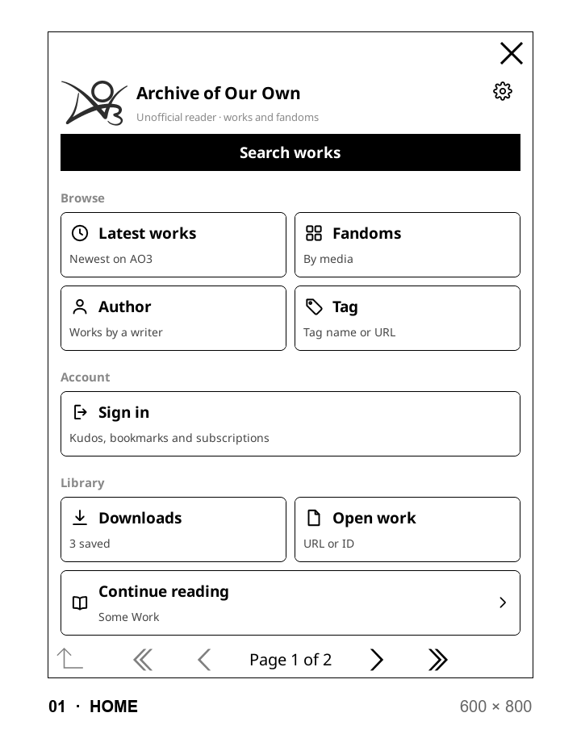
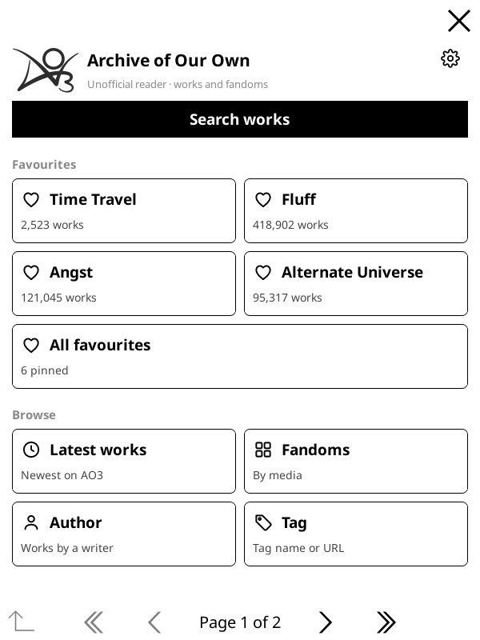
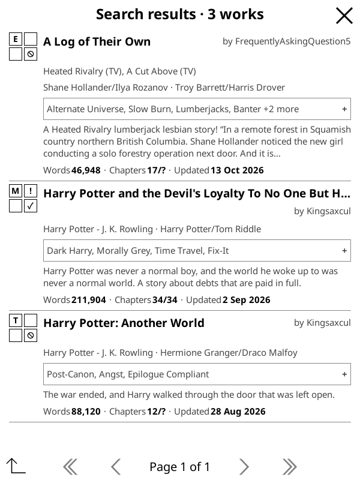
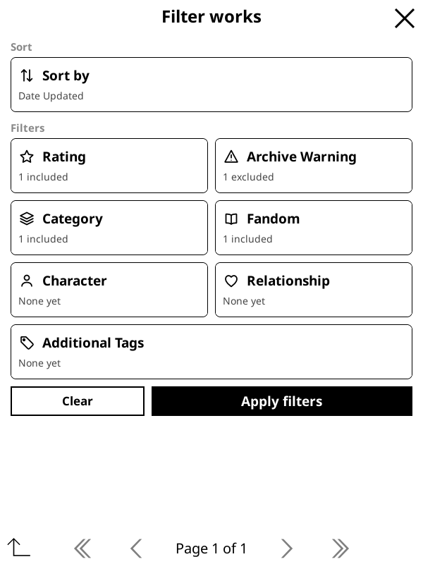
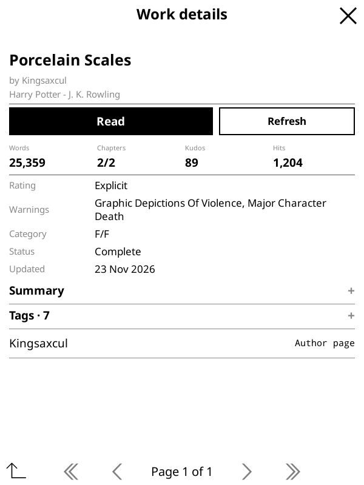
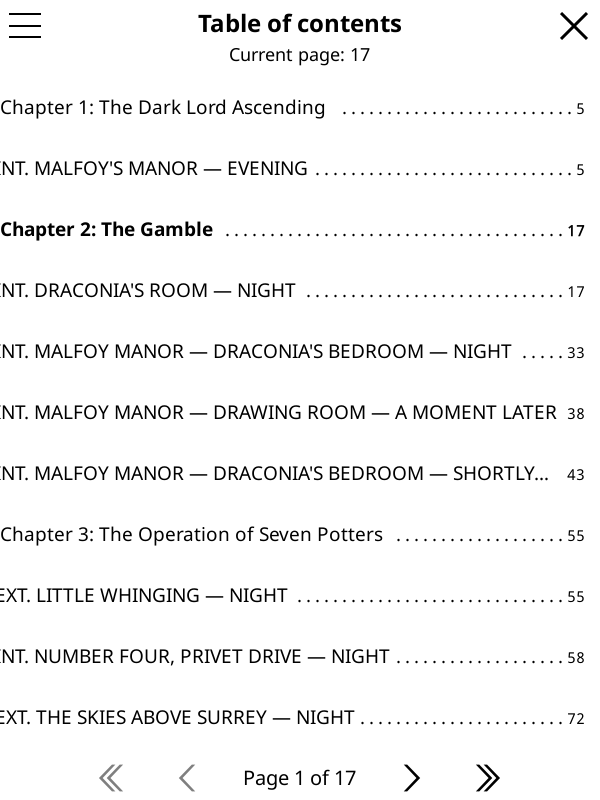
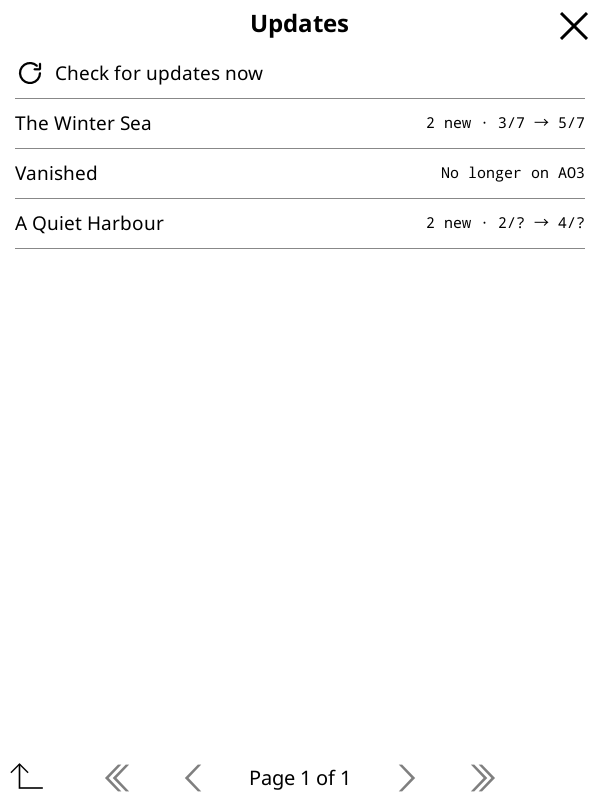

# KO3

**Archive of Our Own, on the device you already read on.**

KO3 is a native AO3 client for [KOReader](https://github.com/koreader/koreader).
It fetches AO3's pages, parses them, and rebuilds them with KOReader's own
widgets — then hands a work's HTML download to the reader. No WebView, no
embedded browser, no rendered website.

  
  
  
  

  

Home → works → filters → details → updates. Captured from KOReader's 600 × 800 emulator.

<strong><a href="https://github.com/hemil2005/KO3/releases/latest">Download the latest release →</a></strong>

Unofficial. Not affiliated with or endorsed by the OTW.

| | |
|:--|:--|
| **Runs on** | KOReader on Kindle and other e-readers |
| **Screen** | 600 × 800 and larger, monochrome |
| **Needs** | Wi-Fi for AO3. Saved works open offline |
| **Account** | Optional. Browsing and downloading public works needs no sign-in |
| **Updates** | In-app, checksum-verified, with one-tap rollback |
| **Price** | Free and open source under AGPL-3.0 |

## What it does

- **Browse without a connection.** An index of 77,535 fandoms ships with the
  plugin, sorted the way AO3 sorts it: media category, letter, fandom. Latest
  works, tag pages and search all use the same work cards.
- **Filter like the site.** Rating, warnings, categories, fandoms, characters,
  relationships and tags, with include and exclude sides; typed tag search
  against AO3's autocomplete; AO3's own sort columns. Bookmark lists add
  Bookmarker's Tags.
- **Read, not browse.** **Read** fetches AO3's HTML download, validates it, and
  opens it in KOReader with a chapter-only table of contents. The Back key, the
  reader menu and the end-of-work dialog all return to AO3.
- **Find people, not just works.** **Author** searches AO3's people directory:
  an exact name opens that author, a partial one lists the accounts it matched.
  Dashboard, Works, Series and Bookmarks are four tabs on one screen.
- **Keep a shelf.** Save works, narrow Downloads by title or number, reopen the
  last one from **Continue reading**, and pin fandoms to **Favourites**.
- **Know when a WIP grows.** A quiet daily check asks for a saved work's chapter
  list, never the work. The bell takes a dot; **Updates** says "2 new · 3/7 →
  5/7"; nothing downloads until you confirm.
- **Bring your account, if you want to.** Bookmarks, Marked for Later, History,
  Subscriptions and your own author page. Kudos, bookmark, subscribe and Mark
  for Later are AO3's own form posts, sent only on tap.
- **Stay current.** Update from inside the plugin; report a bug with an optional
  diagnostic log, no GitHub account needed.

## Screens

<table align="center" width="100%">
<tr>
<td align="center" width="50%"> Search, favourites and the browse tiles</td>
<td align="center" width="50%"> Rating, warnings, ships and tags on one card</td>
</tr>
<tr>
<td align="center" width="50%">  Include and exclude, AO3's own facets</td>
<td align="center" width="50%">  Read, refresh, and the work's record</td>
</tr>
<tr>
<td align="center" width="50%">  Chapters only, no metadata headings</td>
<td align="center" width="50%">  New chapters, waiting for your say-so</td>
</tr>
</table>

**[The gallery →](docs/SCREENSHOTS.md)**

## Install

1. Download the zip from **[the latest release](https://github.com/hemil2005/KO3/releases/latest)**.
2. Unzip it into `koreader/plugins/` on the device. The archive already contains
   the `ao3.koplugin` folder.
3. Restart KOReader.
4. Open **Tools → KO3**.

That is the only manual install. Later versions arrive through **Update KO3**
inside the plugin, with a SHA-256 check and a **Restore previous version**
escape hatch. The full folder layout is in
[Development](docs/DEVELOPMENT.md#repository-layout).

## Limits

- **No comments or posting.** The four work actions are the only writes. There
  is no comment box and no work editing.
- **No images from works.** AO3's text only.
- **Restricted or adult works can still refuse.** Signing in sends your
  session, and the plugin sends `view_adult=true`; if AO3 still returns a login
  or warning page, the download is rejected and any saved copy is kept.
- **The fandom index is a snapshot.** A tag renamed on AO3 after the snapshot
  can 404 until it is regenerated; **Find a tag** resolves current names.
- **One page at a time.** 20 works per page, no infinite scroll.
- **No numeric ranges.** Word count and similar ranges are not exposed; typed
  tags are the free-text filter.
- **AO3 can say no.** A `429` is honoured with `Retry-After`; a bot check is
  not retried, and a form post is never repeated. A VPN or privacy browser can
  trigger that check.
- **A session is optional and local.** If you sign in, AO3's session cookie is
  stored in plain text in KOReader's settings; the password is never stored.
  **Log out** deletes it.
- **Tested in the emulator.** A physical Kindle pass is still recommended.

## Privacy

Browsing is anonymous. Signing in stores AO3's session cookie in
`settings/ao3.lua`; the password is never written. The diagnostic log records
host, path, HTTP status and errors — never passwords, cookies, search text,
work titles or work text — and is attached only with consent. Reports become
public GitHub issues.

[Privacy details →](docs/PRIVACY.md)

## Documentation

- **[User guide](docs/USER-GUIDE.md)** — every screen, filter, setting and account action.
- **[Screenshots](docs/SCREENSHOTS.md)** — the capture gallery, 600 × 800.
- **[Troubleshooting](docs/TROUBLESHOOTING.md)** — 403 and 429, adult pages, updates.
- **[Development](docs/DEVELOPMENT.md)** — network map, verification record, tests, releases.
- **[Privacy](docs/PRIVACY.md)** — storage, logs and bug reports.

Found a bug or have a suggestion? **Report a bug** in the plugin, or
[open an issue](https://github.com/hemil2005/KO3/issues).

## Credits and trademarks

- The Archive of Our Own name and logo are trademarks of the Organization for
  Transformative Works (OTW). `ao3.koplugin/assets/ao3-logo.png` is copied
  byte-for-byte from the OTW's own repository, and
  `ao3.koplugin/assets/ao3-logo.svg` is a vector trace of it. KO3 is unofficial
  and is not affiliated with or endorsed by the OTW.
- AO3's required-tag symbols are redrawn in monochrome in
  `ao3.koplugin/assets/icons/`; the shapes follow AO3's own symbol set, with the
  colour dropped for e-ink.
- [KOReader](https://github.com/koreader/koreader) is made by the KOReader
  contributors.

## License

KO3 is free software: you can redistribute it and/or modify it under the terms
of the GNU Affero General Public License as published by the Free Software
Foundation, version 3. See [LICENSE](LICENSE).

© 2026 hemil2005
