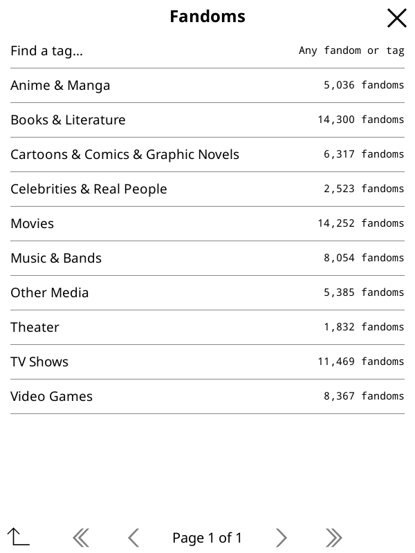
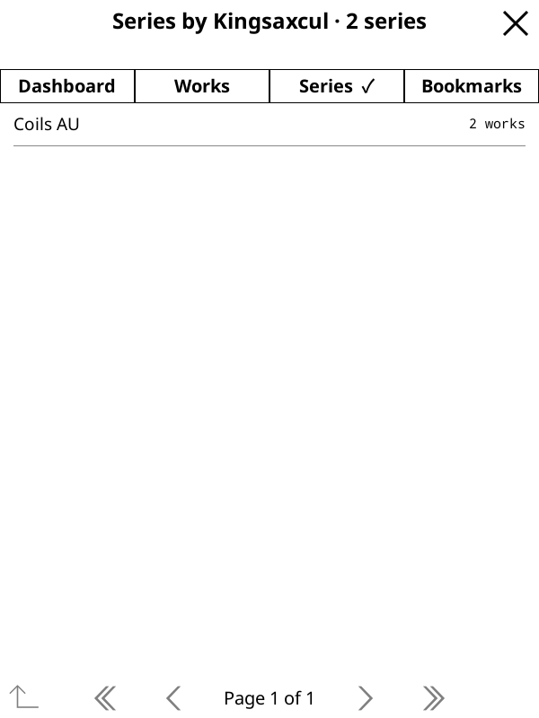

# AO3 browser for KOReader

A deliberately small, read-only browser for [Archive of Our Own](https://archiveofourown.org)
that runs inside KOReader on Kindle (and other e-readers).

It does **not** embed a WebView and never renders AO3's site. AO3 is only a
data source: pages are fetched, parsed, and rebuilt as a native KOReader
`Menu`; a work's HTML download is handed to crengine when you tap **Read**.

- No login
- No images
- No kudos, comments, bookmarks or subscriptions
- No third-party service
- One page fetched per tap; only opened works are saved

## Screenshots

Taken from the KOReader emulator (600×800, grayscale). The work-list and
author-tab shots render real AO3 markup captured offline; the other
browse/detail shots use the plugin and embedded fandom data, with the
details captured from a live work.

| | |
|---|---|
|  |  |
|  |  |
|  |  |
|  |  |
|  |  |
|  |  |
|  | |

## Install

1. Copy the `ao3.koplugin` folder to `koreader/plugins/` on the device
   (over USB, or with whatever file manager you normally use).
2. Restart KOReader.
3. Open **Tools → More tools → AO3**.

The layout should be:

```
koreader/
  plugins/
    ao3.koplugin/
      _meta.lua
      main.lua
      authorpage.lua
      fandompages.lua
      data/fandoms/index.lua
      data/fandoms/<category>/<letter>.tsv.z
```

## Use

One menu entry opens the whole app:

| Home row | What it does |
|---|---|
| **Latest works** | Newest works across the archive (`/works`) |
| **Fandoms** | Categorized fandom index, shipped with the plugin |
| **Search** | Work title, author or keyword |
| **Author** | An author's name or profile URL — their works list |
| **Tag** | A tag name, or paste a full `/tags/.../works` URL |
| **Downloads** | Works already saved on this device |
| **Open work** | Paste `https://archiveofourown.org/works/1234567` or just `1234567` |

Fandoms are browsed media category → letter → fandom, the same way AO3's
own index is organised. Large letters load in local windows of up to 100
fandoms. **Find in this letter…** jumps to a matching name without going
online; tapping a fandom fetches only its 20-work page. Each work is one
selectable card with title, author and up to three lines of summary. On the
AO3 screens, the letter shortcut boxes are hidden so the text gets the full
touchscreen width.

Tap a result to drill in; tap a work for its tags, summary and stats; tap
**Read** to fetch it and open it in the KOReader reader. On the work
screen each author's name opens the author page (co-authors each get a
row; Anonymous stays plain text).

The author page has four tabs in a horizontal strip:

| Tab | What it shows |
|---|---|
| **Dashboard** (default) | The fandoms the author has written in, with work counts. Tapping one opens that author's works in that fandom (AO3's own author-scoped fandom links). |
| **Works** | All of the author's works as the same card listing. |
| **Series** | The author's series, with work counts; tapping one opens the series' works. |
| **Bookmarks** | Works (and series) the author has bookmarked, as cards. |

Each tab is fetched at most once per author visit, so switching back and
forth does not re-request AO3. Back (the footer
arrow, the hardware Back key, the X, or a downward swipe) goes one level up
instead of dropping you into the file manager.

The first read downloads the whole work (usually 200 KB–1 MB); after that the
cached copy opens instantly, offline. **Refresh** downloads and validates the
latest version before replacing the saved copy, so a failed request leaves
the offline book available.

## How it works

```
Browse (offline, data ships with the plugin):
  data/fandoms/index.lua        10 media categories, counts, letters
  data/fandoms/<n>/<L>.tsv.z    one zlib file per category per letter
    77,535 fandoms, 2.6 MB on disk; only the opened letter is decompressed,
    and at most 100 entries become menu rows at once

Listing:
  GET https://archiveofourown.org/works                 (latest works)
  GET https://archiveofourown.org/works/search?work_search[query]=...
  GET https://archiveofourown.org/tags/<tag>/works?page=N
    -> parse <li class="work blurb group"> into 20 selectable work cards

Author page (four tabs):
  GET /users/<name>?expand_fandoms=true       Dashboard: fandoms + counts
  GET /users/<name>/works                     Works
  GET /users/<name>/series                    Series
  GET /users/<name>/bookmarks                 Bookmarks
  GET /users/<name>/works?fandom_id=<id>      one fandom, author-scoped

Reading:
  GET https://download.archiveofourown.org/downloads/<work_id>/work.html
    -> AO3's own HTML download, saved and opened by crengine
```

The fandom snapshot is generated from AO3 with `tools/build_fandoms.py`:

```sh
# Save https://archiveofourown.org/media as 00_media.html, then each
# /media/<category>/fandoms page as 01.html … 10.html in one directory:
python3 tools/build_fandoms.py fandom_pages ao3.koplugin/data/fandoms
```

"Uncategorized Fandoms" is skipped by default: it is ~80,000 unwrangled tags
that would double the snapshot size (`--include-uncategorized` keeps it).

The work file is stored as:

```
koreader/ao3/<work title> [<work id>].html
```

The ID suffix is what the cache lookup uses; the title is there so the file
is readable in the file manager too. Delete the file to force a re-download.

## What was verified

Tested in the KOReader emulator with a native HTTP client (no browser):

- The embedded snapshot: 77,535 fandoms across 10 media categories,
  browsable offline as category → letter → bounded 100-entry windows.
- A live fandom listing (`/tags/Harry Potter .../works`) returned a full
  page with the count and working page navigation.
- Work lists render a single selectable title/author/three-line summary card
  per work, without separate shortcut or description rows.
- The author page (Dashboard / Works / Series / Bookmarks) is built from the
  exact live AO3 markup captured on 2026-11-23, including author-scoped
  fandom links, series stats, work bookmarks and series bookmarks; the four
  tabs render in the emulator (`screenshots/10`–`13`).
- Opening a work downloaded 467 KB `work.html` and rendered it in crengine
  (1/427 pages), with the file saved under `koreader/ao3/`.
- The offline `busted` suite: 106 tests passing across parser, navigation,
  bounded-index, rendered-card interaction, old-build compatibility and
  author-page tests.

**Current connectivity:** AO3 refused the emulator's listing request with
`403`; independent Windows and WSL `curl` requests received `429` on this
connection. Captured once on 2026-11-23, the `429` came from
`Server: cloudflare` with a `CF-Ray` header and the body “The bot servers are
currently overloaded… our systems think you may be a robot… could be due to
using a VPN”. That is Cloudflare's bot-management layer, not AO3's content
rules, and a VPN exit can worsen it. Online search, listings and new
downloads may remain unavailable until AO3 lifts the limit. The plugin spaces
requests one second apart, respects a
numeric `Retry-After` on `429` without immediately retrying, and does not
retry a recognizable browser challenge. Other `403` responses get one retry
before a five-minute cooldown. Offline fandom search and saved
works remain available. No physical Kindle connectivity check has been made.

If AO3 works in your browser but not here, use AO3's **Download → HTML**
button in the browser, transfer the file to your device, and open it from
KOReader's file browser. AO3 currently reports that other download formats
are temporarily disabled. This manual path does not require the plugin's
network client.

The plugin deliberately does not replay Cloudflare's bot cookies: they are
bound to the client that earned them, and sending them back from LuaSocket is
what made the 403 stick for the plugin while `curl` could still fetch pages.

## Limits

- **Public works only.** Works restricted to logged-in users need a session
  and a login flow, which this version deliberately does not have.
- **Adult-gated works** may return the warning page instead of the work.
  The plugin sends `view_adult=true`, but it is not guaranteed.
- **Read-only.** No kudos, comments, bookmarks or subscriptions.
- **No images.** AO3's HTML download references images remotely, and the
  plugin does not fetch them.
- **Snapshot, not live.** The fandom list is a point-in-time copy; tag names
  that were renamed on AO3 after the snapshot will 404 until it is
  regenerated. "Find a tag…" resolves any current tag by name.
- **Simple search.** One query box. AO3's filter matrix (rating, warnings,
  completion, word count, sort) is not exposed. Apps commonly have it; it
  would need a filter screen and is intentionally out of scope here.
- **No infinite scroll.** 20 works per page.
- **Untested on a physical Kindle.** Parsers, UI and rendering were tested
  in the emulator; a real-device pass is still recommended.

## Development and tests

The plugin has a KOReader `busted` suite in `ao3.koplugin/spec/`. It runs
offline against saved AO3 pages and mocked HTTP responses:

```sh
ln -s /path/to/ao3.koplugin plugins/ao3.koplugin
for spec in plugins/ao3.koplugin/spec/ao3*_spec.lua; do
  ln -s "../../$spec" "spec/unit/$(basename "$spec")"
done
./kodev test --busted=--pattern=ao3_ front
```

See `ao3.koplugin/spec/README.md` for details.

### Demonstrating a change in the emulator

Every user-visible change is also shown in the local Kindle emulator
(600×800), not only tested. After the suite is green:

1. Launch the emulator (`kodev run` or the `wl_launch.sh` helper used here).
2. Exercise the real screen with taps/keys, or, when live AO3 is gated,
   render the screen offscreen from the real markup fixtures and write it
   with `Screen.bb:writePNG(...)` from a throwaway busted spec.
3. Save the captures to `screenshots/` and add or update them in the table
   at the top of this README.

Tests prove behaviour; the emulator capture shows the actual result.

## Troubleshooting

| Symptom | Likely cause |
|---|---|
| KOReader exits when opening AO3 | An older KOReader build lacking newer font APIs. Current plugin versions fall back automatically — reinstall the latest `ao3.koplugin` |
| `429` or a wait message | Cloudflare's bot layer (or AO3) is refusing the client. A **VPN or privacy browser can trigger this**; wait the time shown, or turn the VPN off and retry. Do not repeatedly tap or reinstall to bypass it. If AO3 sends `Retry-After`, the plugin honors it. |
| `403` or a wait message | AO3 or its edge refused this client. A recognized browser check is not retried; other 403s get one retry, then a five-minute cooldown. |
| `404` | Work deleted, restricted, or downloads disabled |
| “did not return a work file” | Restricted/adult/login page instead of the work |
| “Could not parse the AO3 page” | AO3 changed its HTML, or `htmlparser` failed |
| Nothing happens after tapping Read | Check Wi-Fi and that the Kindle is online |

If a work opens as a login page or an adult warning, the file is rejected
before it reaches the reader, so you should see an error rather than a
broken book.
